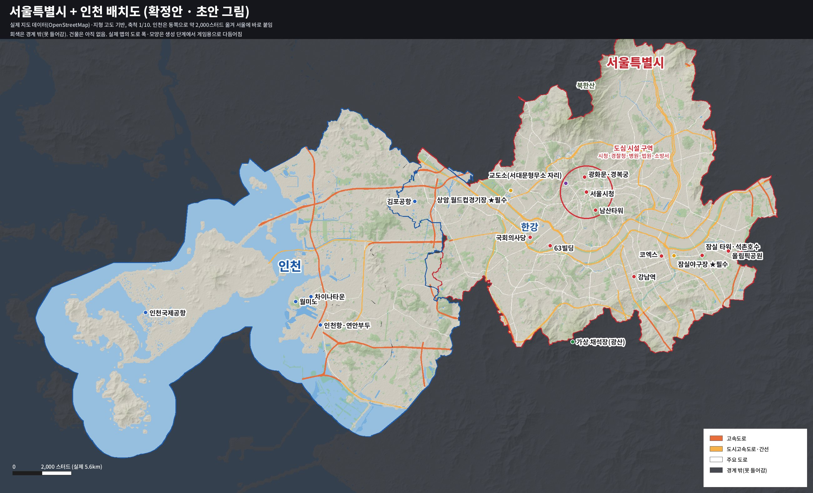

# 맵 설계서 v0.1 — 서울특별시 + 인천

로블록스 인생모드(RP) 게임의 맵 설계입니다. 아직 맵은 만들지 않았고, 아래 내용을 확정한 뒤 단계별로 제작합니다.

> 그림은 실제 지도 데이터로 그린 배치도 초안입니다. 건물은 아직 없고, 도로 폭과 모양은 생성 단계에서 게임용으로 다듬어집니다.

## 1. 기본 방향

| 항목 | 결정 |
|---|---|
| 도시 분위기 | 한국 도시 (한글 간판, 아파트 단지, 24시 편의점, 가로형 신호등) |
| 지역 | 서울특별시 전체 + 인천(본토와 영종도) |
| 재현 수준 | 실제 지도 데이터 기반 |
| 축척 | 1/10 |
| 맵 크기 | 큰 도시. 서버당 50~100명 이상을 목표로 함 |
| 제작 방식 | 전부 코드로 생성 (지도 데이터 → 생성 코드 → Studio에서 여는 게임 파일) |
| 맵 경계 | 경계 밖으로는 못 나가게 막음 |
| 낮밤·날씨 | 낮밤 순환과 날씨 변화(비, 안개). 밤에는 가로등과 건물 불빛이 켜짐 |
| 제작 순서 | 전체 뼈대를 먼저 만들고, 건물은 구역별로 채움 |

## 2. 지역 구성

**서울특별시**
- 실제 서울시 경계, 한강 물길, 주요 도로, 산(북한산·관악산·남산 등)을 그대로 줄여서 만듭니다.

**인천**
- 본토와 영종도(인천국제공항)만 넣습니다. 강화도와 먼 섬들은 뺍니다.
- 실제로는 서울과 인천 사이에 부천이 있지만, 인천 전체를 동쪽으로 약 2,000스터드 옮겨 서울에 바로 붙입니다.
- 옮기면서 서울과 겹치는 계양구 동쪽 일부는 잘라냅니다. 겹치는 곳은 서울(강서구)이 우선입니다.
- 바다는 해안에서 1,000스터드까지만 넣습니다.

**경계**
- 플레이 구역 바깥은 투명 벽으로 막습니다.
- 경계 밖에는 지형을 배경으로만 보여줍니다.

## 3. 축척과 크기

- **축척:** 1/10입니다. 로블록스 캐릭터 기준으로 1스터드를 0.28m로 보면, 실제 2.8m가 게임 속 1스터드입니다.
- **전체 크기:** 약 25,100 × 14,300스터드입니다. 서울만 따지면 약 13,200 × 10,800스터드입니다.
- **산 높이:** 1.5배 과장합니다. 도시를 1/10로 줄이면 산이 낮아 보이기 때문입니다.
- **이동 시간(예상):** 차로 서울 동서 끝에서 끝까지 약 2분, 인천공항에서 잠실까지 약 4분입니다.

## 4. 랜드마크

실제 회사 이름과 로고는 넣지 않습니다.

| 지역 | 랜드마크 |
|---|---|
| **필수** | **상암 월드컵경기장, 잠실야구장** |
| 강북 도심 | 광화문광장, 경복궁, 서울시청, 남산타워 |
| 여의도 | 국회의사당, 63빌딩, 금융가, 한강공원 |
| 강남 | 강남역 사거리, 테헤란로 업무지구, 코엑스 일대 |
| 잠실 | 초고층 타워, 석촌호수, 올림픽공원, 종합운동장 |
| 인천 | 인천국제공항, 인천항·연안부두, 월미도·차이나타운 |
| 공항 | 김포공항(서울 강서구), 인천국제공항 |

## 5. 시설 배치

**도심 시설 구역** (서울시청 반경 약 900스터드)
- 시청, 경찰청, 병원, 법원, 소방서를 모읍니다. 플레이어가 한곳에 모이게 하려는 목적입니다.

**교도소**
- 도심 바로 옆 서대문형무소 자리에 둡니다.

**동네마다 두는 생활 시설**
- 은행, 편의점, 차량 대리점, 주유소, 정비소

**추가 시설**
- **여가:** 식당·카페, PC방, 노래방, 헬스장, 영화관, 공원
- **범죄 콘텐츠용 장소:** 보석상, 은행 금고, 갱 아지트, 뒷골목 암시장
- **교육:** 학교, 대학교

**가상 콘텐츠**
- **채석장(광산):** 관악산 안에 둡니다.
- **농장:** 강서구 서쪽과 계양구 들녘에 논밭과 비닐하우스를 둡니다.

## 6. 집과 실내

- **집 종류:** 아파트 단지(동·호수별), 빌라·원룸(초반용), 단독·전원주택, 고급 주택·펜트하우스
- **실내 방식:** 섞어서 씁니다.
  - 시청·경찰서·병원·은행·상점은 문을 열고 그대로 걸어 들어갑니다.
  - 아파트 세대와 집 내부는 문 앞에서 별도 실내 공간으로 순간이동합니다.

## 7. 교통

- **지금:** 고속도로, 도시고속도로, 간선도로, 한강 다리
- **나중에:** 버스(정류장·차고지), 지하철, 기차
  - 실제 철도 노선을 따라 자리를 비워 두어, 나중에 맵을 다시 짜지 않고 추가할 수 있게 합니다.

## 8. 제작 단계

1. **뼈대:** 지형(산·한강·바다), 경계, 도로·고속도로·다리, 구역 나누기
2. **구역별 건물:** 순서는 1단계를 마친 뒤 정합니다.
3. **랜드마크:** 따로 제작합니다.

## 9. 기술 메모 (개발용)

**데이터와 출처 표시**
- **지도 데이터:** OpenStreetMap(BBBike 서울 추출본)을 씁니다. 추출본 범위 밖인 영종도는 따로 받아야 합니다.
- **지형 고도:** AWS Terrain Tiles(Terrarium)를 씁니다.
- **출처 표시:** OpenStreetMap 데이터(ODbL 라이선스)를 쓰므로 게임 안에 "© OpenStreetMap contributors"를 표시해야 합니다.
- **행정구역:** 2026년 인천 행정구역 개편(제물포구·영종구·서해구·검단구)이 데이터에 반영돼 있습니다.

**좌표와 성능**
- **원점:** 맵 중심을 원점으로 다시 잡아 좌표가 ±13,000스터드 안에 들어오게 합니다.
- **스트리밍:** 큰 맵이라 StreamingEnabled를 켭니다.

**도로와 건물 크기**
- **도로 폭:** 게임 기준으로 정합니다. 실제 폭을 1/10로 줄이면 차가 다닐 수 없기 때문입니다.
- **포함할 도로:** 고속도로, 도시고속도로, 간선도로까지 넣습니다. 블록 안 골목은 자동으로 생성합니다.
- **건물:** 실제 건물을 1/10로 줄이면 너무 작아집니다. 그래서 동네 성격(주거·상업·업무)에 맞춰 게임 크기로 자동 생성합니다.

**지형 생성**
- 로블록스 지형(Terrain)은 지금 쓰는 도구로 게임 파일에 바로 넣기 어렵습니다. 그래서 생성 스크립트로 만듭니다.
- 서버 시작 때 자동으로 만들지, Studio 명령줄에서 한 번 실행해 저장할지는 1단계에서 정합니다.

## 10. 아직 정하지 않은 것

- 지형 생성 방식 (1단계에서 테스트 후 결정)
- 구역별 건물을 채우는 순서
